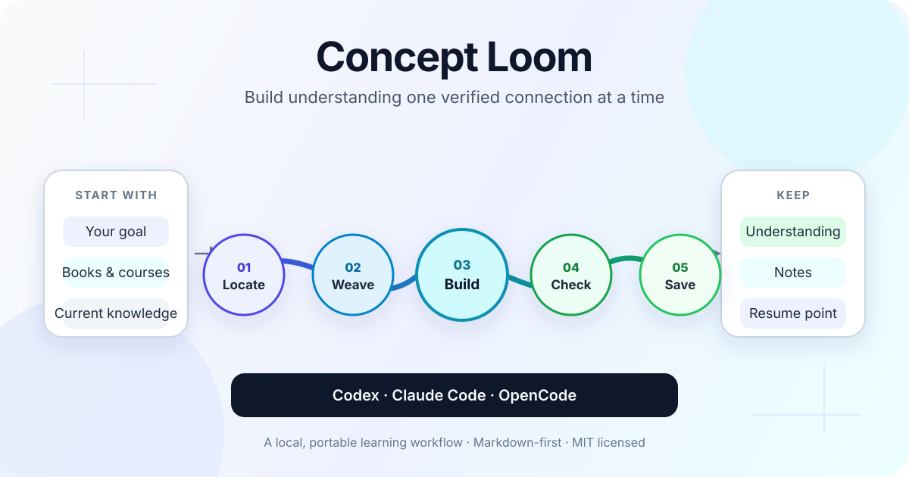

<p align="center">
  
</p>

# Concept Loom

**Turn your AI coding assistant into a learning coach that remembers what you know.**

Works with Codex, Claude Code, OpenCode, DeepSeek Harness, and Pi · MIT licensed · Node.js 20+

[English](#concept-loom) · [Русский](docs/ru/README.md)

Instead of dumping a long explanation, Concept Loom finds the edge of what you already understand, proposes a short path to your goal, teaches one idea at a time, and checks that it stuck. It remembers your progress between sessions, and across projects.

```text
goal → what you already know → short route → one idea → check → review later
```

It works for topics you explore from scratch and for your own books, courses, notes, code, and transcripts.

## What you get

| | |
|---|---|
| **A route, not a lecture** | A short dependency path to your goal instead of a survey of the whole field. |
| **Honest checks** | Questions with concealed answers. Recognition, recall, application, and transfer are measured separately. |
| **Memory across sessions** | Close the chat and continue tomorrow from the exact step. Due concepts come back for spaced review. |
| **Memory across projects** | Learned Docker last month? When you start Kubernetes, the coach builds on it. Old knowledge is re-checked with a quick question, not assumed. |
| **Long-term goals** | Split a big goal ("write a Go backend") into milestones. Each milestone is its own focused session, and the coach picks what to do next. |
| **Notes and diagrams** | A Markdown learning notebook, plus text or Mermaid diagrams right in the conversation. |

## Quick start

You need [Node.js 20+](https://nodejs.org) and one of the supported AI clients.

### 1. Install into a learning folder

Make one folder per topic and install Concept Loom into it. Run this from the Concept Loom repository:

```bash
node scripts/setup.mjs <client> --target ~/learning/my-topic
```

Replace `<client>` with the tool you use:

| You use | Replace `<client>` with | Then start it with |
|---|---|---|
| Codex | `codex` | `codex` |
| Claude Code | `claude-code` | `claude` |
| OpenCode | `opencode` | `opencode` |
| DeepSeek Harness | `deepseek-harness` | `npx @deepseek-ai/dsh --profile web --patch .dsh/concept-loom.patch.yml` |
| Pi | `pi` | `pi` |

### 2. Start your client in that folder

```bash
cd ~/learning/my-topic
claude        # or the start command from the table above
```

On first start, Pi asks you to trust the project so it can load the project's `.pi/mcp.json`.

### 3. Tell it what you want to learn

```text
Use concept-coach. I want to understand database transactions well enough
to choose the right isolation level for a small web application.
```

In Codex, write `$concept-coach` instead of `concept-coach`.

That is all. The coach asks a few questions, shows a route, waits for your approval, and starts teaching.

## Everyday use

Just talk to it. There are no extra commands to learn.

| You say | What happens |
|---|---|
| "Continue" | Restores your last session, or the next milestone of your goal, and picks up where you stopped. |
| "This is a big topic, make a goal with milestones" | Proposes ordered milestones, saves them after you approve, and teaches one per session. |
| "I want to learn Kubernetes" | Looks up related things you already learned, such as Docker, and skips or shortens what you know. |
| "I forgot how Docker volumes work" | Marks it for re-checking before building on it. |
| "Show me what you know about me" | Lists everything in your knowledge map and how fresh it is. |
| "Import my past sessions into the knowledge map" | One-time import of the sessions already saved in this folder. Run it once per old project. |

## Where your data lives

| What | Where |
|---|---|
| Sessions, goals, and progress | `<your-topic-folder>/.concept-loom/` |
| Markdown notebook | `<your-topic-folder>/learning-notes.md` |
| Knowledge map across projects | `~/.concept-loom/knowledge.json` |

Everything stays on your computer. Nothing is sent anywhere by Concept Loom itself. To move the knowledge map, set the `CONCEPT_LOOM_HOME` environment variable to another folder. To turn it off, set it to `off`.

Knowledge that has not been verified for 90 days is treated as "needs verification", because memory fades. The coach re-checks it with a short question instead of trusting it.

## Updating

Pull the new version of Concept Loom, then refresh the skill in each learning folder:

```bash
node scripts/setup.mjs <client> --target ~/learning/my-topic --refresh
```

`--refresh` replaces the coaching skill (and, for DeepSeek Harness, its MCP patch) and leaves your notes, sessions, and other configuration alone. Do this after every update so the coach learns about new features.

## Good to know

- The installer never overwrites existing configuration. If a `CLAUDE.md`, `AGENTS.md`, or MCP config already exists, it writes a separate `CONCEPT_LOOM_*.md` file for you to merge by hand.
- `--skip-mcp` installs only the files and leaves your global client configuration untouched.
- Codex registers the MCP server globally; the other clients keep it in the learning folder.
- DeepSeek Harness is a developer preview, so its configuration format may change.
- Concept Loom has no runtime npm dependencies.

## Documentation

| Guide | Use it when… |
|---|---|
| [How Concept Loom works](docs/en/how-it-works.md) | You want to understand the method, the tools, and the architecture. |
| [Learning from scratch](docs/en/learning-from-scratch.md) | You are starting without a book or course. |
| [Learning with source materials](docs/en/learning-with-source-materials.md) | You have PDFs, EPUBs, notes, videos, code, or course files. |

## Development

```bash
npm run verify   # syntax checks and all tests
```

## License

MIT. Security reports: [SECURITY.md](SECURITY.md). Release history: [CHANGELOG.md](CHANGELOG.md).
